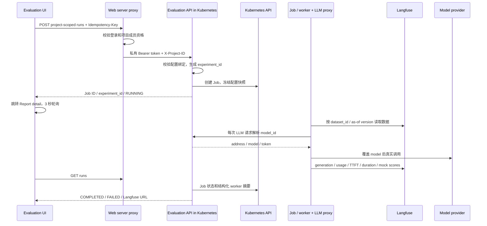

# Evaluation 分支工作与后端接续交接

更新：2026-10-20。原分支：`codex/tali-pre-guardrail-ui`。本文记录截至本次同步的实际状态；旧设计稿中未完成的能力仍是规划，不能作为已实现功能。

## 1. 工程位置和 Git 边界

| 工程 | 本机路径 | Git 状态与职责 |
|---|---|---|
| 主工程、Web、Langfuse Compose | `C:/zzz/code/ai/AgentEval` | 原分支 `codex/tali-pre-guardrail-ui`；前端和接入文档在此提交 |
| 本聊天工作树 | `C:/Users/o_lyn/.codex/worktrees/82a2/AgentEval` | 起点 `ad8340e`，detached HEAD；与原工程共享提交历史 |
| 独立后端 | `C:/zzz/code/ai/AgentEval/evaluation-backend` | 独立 Git 仓库，当前 `main`；主工程 `.gitignore` 忽略 `/evaluation-backend/`，不是 submodule |

WSL 中原工程路径为 `/mnt/c/zzz/code/ai/AgentEval`。前端开发服务实际从原工程启动，不能仅修改聊天工作树后就认为浏览器页面已更新。后端独立仓库没有自动成为主工程提交的一部分，换机器时需另行迁移/配置远端。

独立后端本次保存为首个提交 `0a1f293`（`main`，runner、LLM 代理、Langfuse 和 Kubernetes Trigger）；尚未配置远端或推送。

## 2. 已完成的界面工作

- 侧栏和面包屑统一为 **Evaluation**。先选 Target type，然后以列表展示 Target；目前仅 Guardrail，最后一列提供 **History / Trigger**。
- History 放在对应 Target 的弹窗中；主页面不再常驻历史列表。Trigger 固定列表中选定的 Target，移除重复 Target 选择和详情。
- 配置弹窗选择 Dataset/版本、Environment；移除 Review，按钮统一为 **Run evaluation**。提交后立即进入报告详情。
- Dataset 可设置可选 scorer 集合；Scorer 可反查关联的 Dataset 及版本。空集合表示不限制可选 scorer。
- 风险分类文案围绕 **Guardrail conversation safety** 的 `messages`、`has_issue`、`category`；6 条默认 case，布尔风险标准答案。
- Environment 的 Model ID 注解说明会重写发给 Stork 的请求 model。原演示执行环境固定显示 OpenShell。
- 非两类管理员角色的 Evaluation 分组仅展示 **Evaluation / Reports**；菜单规则不代替服务端授权。
- 旧 fixture 报告仍是演示。Dataset/Environment/Scorer 编辑仍在内存中，刷新会重置；不要把它们当作后端资源 CRUD。

## 3. 真实 Trigger 链路



浏览器接口：`/api/v1/projects/{projectId}/evaluation-execution/{path}`。后端接口：

| Method / path（后端前缀 `/api/v1/evaluations`） | 用途 |
|---|---|
| GET `/config` | 允许的资源绑定、runtime、target/scoring mode |
| POST `/runs` | 校验配置、生成 ID、创建真实 Job；同项目同幂等键同请求返回原任务，不同请求 409 |
| GET `/runs` | 当前项目历史；用于刷新后恢复报告 |
| GET `/runs/{jobName}` | 查询单次运行状态和完成摘要 |

后端入口是独立工程 `src/evaluation_backend/api.py`、`runs.py`、`k8s_job.py`。前端入口：

- `web/apps/control/src/features/evaluation-workbench/eval-page.tsx`：配置和提交。
- 同目录 `remote.ts`：携带当前登录 token 的请求和 remote DTO 转换。
- 同目录 `provider.tsx`：真实运行轮询；remote 任务不进入模拟推进器。
- 同目录 `reports-page.tsx`：排队/执行中/完成/失败、experiment/job/model/scorer 信息和 Langfuse 链接。
- `web/apps/control/server/routes/api/v1/projects/[projectId]/evaluation-execution/[...path].ts`：项目授权、同源 POST 校验、服务端凭据代理；不向浏览器下发 Trigger token。

当前服务端配置 `EVAL_RESOURCE_BINDINGS` 允许：`guardrail-privacy` + `ds-guardrail` v1 + `env-isolated` + `glm-dev`。
UI dataset 映射到 Langfuse ID `cmvff7e84000dpq4o7rg21lhd`，as-of 时间固定为 `2026-10-20T06:00:00Z`。新 UI 版本需要显式增加服务端绑定。

重要边界：当前真实 Target 是 LLM 风险分类适配器，并未加载完整 Guardrail library。真实执行仅安装 `mock-score`，固定分数 1；UI 明确标注 development mock，不把原策略/风险 scorer 静默当作已执行。执行为普通 Kubernetes Job，未应用 OpenShell 的网络、命令和路径策略。样本计数在 worker 完成摘要后更新，暂未实现逐样本实时流。

## 4. 后端 runner、代理和平台抽象

- 独立后端包含 Docker/Kubernetes 载体工具、OpenShell runner、沙箱内 worker、Langfuse dataset/experiment 适配、评分器库接口及结果投递抽象。
- `openshell_runner` 支持选择已部署 Gateway；不是在 container 内嵌套启动 Docker。OpenShell 的 Kubernetes Gateway/controller 尚未部署验收；**当前 Web Trigger 走直接 Kubernetes Job**。
- 每次新提交生成 `experiment_id`；worker 环境的 `EXPERIMENT_ID / EVALUATE_ID / EVALUATION_ID` 一致。OTEL span、generation、评分 metadata 都带该标签。
- 容器内 LLM 代理通过 SDK base URL 接管 OpenAI Chat Completions 请求；每次向后端 `GET /internal/models/{model_id}` 解析配置，覆盖发送给上游的模型。
- `EVAL_MODEL_REGISTRY` 指向忽略的模型配置 JSON；模型 token 不写入代码或 Job annotation。代理不把供应商 token 交给目标 workload。
- 代理记录输入/输出 token、首 token 时间、耗时、请求模型和实际响应模型；通过 traceparent 关联 worker trace。
- worker 直接从 Langfuse 读取 Dataset，真实反馈 experiment/score。平台边界使用 DatasetSource / ScorerLibrary / ExperimentReporter；LangSmith 尚未实现。outbox、持久业务模型等仍是后续规划。
- 模型返回完整 Markdown JSON 代码块已兼容，保留严格 `has_issue: boolean` 校验。

独立后端详细文档：`docs/runner.md`、`docs/openshell-worker.md`、`docs/llm-proxy.md`、`deploy/kubernetes/README.md`。

## 5. 本机部署与重启

| 服务 | 位置 |
|---|---|
| Web | `http://127.0.0.1:18082`，WSL Node 24 |
| Kubernetes API 服务 | Namespace `evaluation`，Deployment/Service `evaluation-api:8001` |
| API 本机转发 | `http://127.0.0.1:18001`，依赖 port-forward 进程 |
| Langfuse | `http://localhost:3000`，Compose project 固定 `langfuse` |
| 模型 | `glm-dev`，后端 registry 请求 `glm-4.7` |

当前镜像：`docker.io/ianwoolf/evaluation-worker:k8s-20261020-r3`。
Digest：`sha256:ba1b089e0a85796664e3a218db44a133f3a3cddc9118dbc8667af1d9fe73bd9e`。
部署清单使用 YAML，位于独立后端 `deploy/kubernetes/services.yaml`；凭据由本地忽略配置渲染到 Secret，不能提交 Secret 实值。

```bash
# Windows PowerShell / 已配置 kubectl 的 WSL
kubectl --context docker-desktop -n evaluation port-forward service/evaluation-api 18001:8001 --address 127.0.0.1

# WSL，另开终端；已有本机脚本会加载私有 Trigger 配置
bash /mnt/c/zzz/code/ai/AgentEval/data/start-control.sh

# 从主工程运行；Compose 会读取 langfuse/.env
docker compose -p langfuse -f langfuse/docker-compose.yml up -d
```

前端 server 读取 `EVAL_EXECUTION_API_URL` 和 `EVAL_TRIGGER_TOKEN`；本机值在独立后端忽略的 `data/trigger.env`。API rollout 后要重新启动 port-forward。API ServiceAccount 仅在 `evaluation` namespace 内拥有 Job create/get/list 和 Pod/log get/list；worker 不挂载 Kubernetes token。没有挂载 Docker/containerd socket，没有部署未认证的 NodePort Registry。

WSL 已经用户授权从 mirrored 改为 NAT 并重启；此前的 OpenShell/seccomp 问题在该调整后恢复。该机器配置不随 Git 同步。

## 6. GLM 4.7 为什么返回 5.3

实际回读确认：请求 `generation.model=glm-4.7`，供应商返回 `metadata.response_model=glm-5.3-flash`。不是前端把模型名改为了 5.3。

智谱官方 [Coding Plan 套餐概览](https://docs.bigmodel.cn/cn/coding-plan/overview) 明确写明：调用历史 GLM-4.7 会自动切换到 GLM-5.3-Flash。这与当前现象一致，但不能仅凭此判断当前 API Key 的套餐类型。若必须固定真实 4.7，需要供应商提供仍保留该模型的账户/部署路由；修改大小写不能阻止服务端映射。没有擅自更换 endpoint 或伪装响应模型。

## 7. 验证证据

- 后端既有 67 项测试及新增 4 项 Trigger 测试通过；覆盖认证、配置绑定、幂等、固定版本、项目隔离与完成摘要。
- 前端 domain 11 项、界面交互 8 项测试及 TypeScript 检查通过。WSL 挂载盘首次 fork worker 曾超时；切换 `--pool=threads --maxWorkers=1` 后界面测试通过。
- 浏览器实际点击 Run，跳转运行中报告，完成后展示 6 条处理数据；刷新后恢复同一报告。
- 验收 Job：`eval-f816193a3eb7a492e0960a42`，Complete 1/1。
- runner experiment_id：`exp-92329cdd056c43e4846a302da683788e`；Langfuse 原生 experiment ID：`4c5b2f61f08a464a`。
- Langfuse 回读：6 generation、6 score；token usage、TTFT、duration 均存在；请求和响应模型分别为 4.7 / 5.3-flash。
- 截图：[真实测评完成](../../output/frontend-trigger-verified.png)。架构 PPT 位于主工程 `output/`。

```bash
# 独立后端目录
.venv/bin/python -m pytest -q

# 主工程 web/apps/control；使用 Node 24
../../node_modules/.bin/vitest run --config vitest.config.ts \
  src/features/evaluation-workbench/workbench.test.tsx \
  src/features/evaluation-workbench/domain.test.ts --pool=threads --maxWorkers=1
../../node_modules/.bin/tsc --noEmit -p tsconfig.json
```

## 8. 后续优先项

1. 固化后端仓库远端和 CI/依赖版本；资源 CRUD 与不可变版本持久化，替换 UI fixtures。
2. 真正的 Guardrail target/scorer library 加载；固定 artifact/commit/hash、评分器版本和数据版本，移除临时 mock。
3. 明确 Job 与 OpenShell Gateway 两种执行方式的配置和策略边界，完成 OpenShell Kubernetes 部署与隔离验收。
4. 取消、超时协调、重试/attempt、逐样本进度、真实报告明细及 Job 历史清理策略。
5. 实现 LangSmith adapter、可靠投递/重试与 outbox；目前只有接口抽离，不表示切换已可用。

不要提交 `.env`、`data/`、模型/API token、Kubernetes Secret 实值、数据库、日志、虚拟环境和构建缓存。历史设计参见 [backend-execution-design.md](backend-execution-design.md)，当前运行事实以本文和独立后端部署说明为准。
